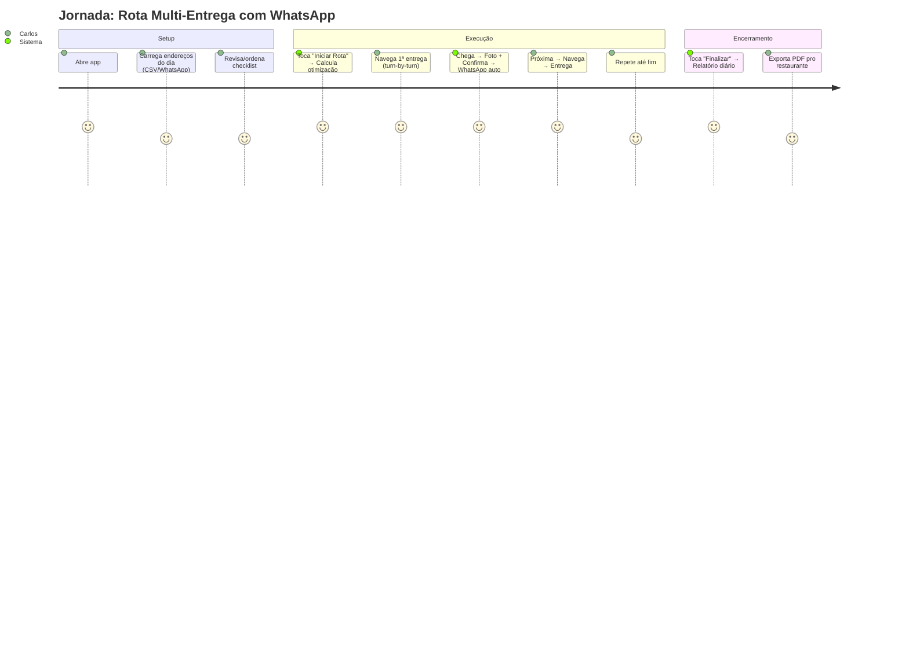

# Visão e Escopo — EntregaFácil

**Versão:** 0.1  
**Data:** 2026-11-17  
**Autor:** PLANMASTER  
**Branch:** develop

---

## 1. Declaração do Problema

Motoristas de aplicativos de entrega (iFood, Uber Eats, 99Food, Rappi) e motoboys autônomos enfrentam ineficiência na roteirização de múltiplas entregas simultâneas. Atualmente:
- Apps nativos não otimizam rotas multi-parada (apenas next-best)
- Falta integração nativa para notificar cliente/destinatário via WhatsApp ao entregar
- Checklists manuais em papel ou notas do celular propensos a erro
- Perda de tempo e combustível por rotas subótimas
- Ausência de comprovante digital estruturado (foto, assinatura, timestamp, GPS)

## 2. Público-Alvo

| Perfil | Descrição | Dor Principal |
|--------|-----------|---------------|
| **Motoboy App** | Trabalha para iFood/Uber/99/Rappi, 8-12h/dia, 20-50 entregas/dia | Roteirização ineficiente, apps nativos não otimizam multi-parada |
| **Motoboy Autônomo** | Próprio negócio, atende restaurantes/comércios locais, 10-30 entregas/dia | Gestão manual de rotas, sem comprovante digital, comunicação WhatsApp manual |
| **Gestor de Frota Pequena** | 3-20 motoboys, precisa monitorar e auditar entregas | Falta visibilidade em tempo real, relatórios manuais |

## 3. Objetivos do Produto

| Objetivo | Métrica de Sucesso (KPI) |
|----------|--------------------------|
| Reduzir tempo total de rota em ≥ 15% | Tempo médio/entrega ↓ 15% vs app nativo |
| Aumentar taxa de comprovação de entrega | 100% entregas com foto+GPS+timestamp |
| Automatizar notificação WhatsApp | 95% notificações enviadas sem intervenção manual |
| Funcionar em áreas com sinal instável | 90% rotas calculadas offline (cache) |
| Time-to-first-delivery < 3 min | Do abre-app à 1ª entrega navegando |

## 4. Escopo — IN (MVP v0.1)

| ID | Funcionalidade | Descrição |
|----|----------------|-----------|
| IN-01 | **Cadastro de Endereços** | Adicionar/editar/remover endereços via busca (Google Places/OSM), importação CSV, digitação manual |
| IN-02 | **Checklist de Entregas** | Lista reordenável (drag-drop), status: Pendente → Em Rota → Entregue → Problema |
| IN-03 | **Otimização de Rota (VRP)** | Algoritmo TSP/VRP (capacidade, janelas de tempo, prioridade) - roda offline via OSRM/GraphHopper local |
| IN-04 | **Navegação Turn-by-Turn** | Integração com MapLibre/Mapbox Navigation SDK offline, recálculo automático se desvio |
| IN-05 | **Comprovação de Entrega** | Foto obrigatória + GPS + timestamp + assinatura digital (opcional) + observações |
| IN-06 | **Notificação WhatsApp (Evolution API)** | Template: "Sua entrega #123 foi entregue em [endereço] às [hora]. Foto: [link]. Assinatura: [link]" - remetente: motorista OU destinatário (configurável) |
| IN-07 | **Modo Offline Parcial** | Cache de tiles (MapLibre), rotas pré-calculadas, sync automático quando online |
| IN-08 | **Histórico & Relatórios** | Filtros por data, status, cliente; export CSV/PDF; resumo diário (km, tempo, ganhos estimados) |
| IN-09 | **Perfil Motorista** | Nome, foto, veículo (placa, modelo), WhatsApp, preferências (som, unidade, tema) |

## 5. Escopo — OUT (Não no MVP)

| ID | Funcionalidade | Motivo |
|----|----------------|--------|
| OUT-01 | Integração direta com APIs iFood/Uber/99 | Requer parceria oficial, OAuth, rate limits, compliance |
| OUT-02 | Gestão de pagamentos/boleto/Pix | Fora do core, complexidade regulatória |
| OUT-03 | App para cliente final (rastreio) | Foco no motorista; pode ser fase 2 |
| OUT-04 | Dashboard web para gestor de frota | MVP mobile-first; web admin v0.2 |
| OUT-05 | Gamificação (badges, ranking) | Nice-to-hold, não essencial |
| OUT-06 | IA para previsão de demanda | Dados insuficientes no MVP |
| OUT-07 | Multi-idioma (apenas PT-BR v0.1) | Escopo controlado |

## 6. Restrições

| Tipo | Detalhe |
|------|---------|
| **Técnica** | Android 8+ (API 26), iOS 15+; APK < 100MB; offline-first architecture |
| **Regulatória** | LGPD (dados pessoais, localização, fotos), Lei do Motoboy (12.009/2009), acessibilidade WCAG 2.1 AA |
| **Infra** | Evolution API self-hosted (Docker) ou SaaS; OSRM/GraphHopper self-hosted; MapLibre tiles (MBTiles) |
| **Prazo** | MVP em 8-10 semanas (2-week sprints) |
| **Orçamento** | Zero custo licença (open source); custo apenas hospedagem VPS + Evolution API |

## 7. Stakeholders

| Papel | Nome/Contato | Responsabilidade |
|-------|--------------|------------------|
| **Product Owner** | [A definir] | Priorização, validação AC, aceitação sprint |
| **Tech Lead** | [A definir] | Arquitetura, code review, decisões técnicas |
| **Dev Mobile** | [A definir] | React Native/Expo, mapas, offline, build |
| **Dev Backend** | [A definir] | Evolution API, OSRM/GraphHopper, sync API, database |
| **QA** | [A definir] | Testes device farm, campo, acessibilidade |
| **Motorista Beta** | 3-5 motoboys reais | Validação UX campo, feedback semanal |

## 8. Personas & Jornadas

### Persona 1: **Carlos "Carlão" Silva**, 34 anos, Motoboy iFood/Ubereats
- **Experiência:** 6 anos, conhece a cidade "de cor", usa 2 celulares (pessoal + trabalho)
- **Dia típico:** 10h online, 35 entregas, rota caótica entre apps
- **Dores:** Apps não conversam, perde tempo decidindo próxima entrega, cliente liga cobrando
- **Objetivo com EntregaFácil:** "Colocar todos endereços, dar play, e só pilotar. WhatsApp avisa sozinho."

### Persona 2: **Marina Santos**, 28 anos, Motoboys Autônoma (restaurantes zona sul)
- **Experiência:** 3 anos, carteira fixa 8 restaurantes, agenda por WhatsApp
- **Dia típico:** Pega 15-20 pacotes manhã, roteiriza mental, foto no celular, manda WhatsApp manual
- **Dores:** Esquece foto, manda msg errada, não tem relatório pro restaurante
- **Objetivo:** "Checklist que não falha, foto obrigatória, relatório automático pro dono."

### Jornada Principal (Happy Path)

## 9. Critérios de Sucesso (Go/No-Go MVP)

| Critério | Target | Como Medir |
|----------|--------|------------|
| Roteirização < 3s para 20 paradas | ✅ | Benchmark device médio (Snapdragon 680) |
| APK size < 80MB | ✅ | `./gradlew bundleRelease` / `eas build` |
| Offline: 100% rotas cached funcionam | ✅ | Teste campo: modo avião + 10 entregas |
| WhatsApp delivery rate > 98% | ✅ | Logs Evolution API + confirm receipt |
| Crash-free sessions > 99.5% | ✅ | Play Console / Sentry |
| Acessibilidade: 0 violações AA | ✅ | axe-core + TalkBack/VoiceOver manual |

---

**Próximo passo:** FASE 2 — Benchmarks referenciais (stack, roteirização, WhatsApp, mapas offline)