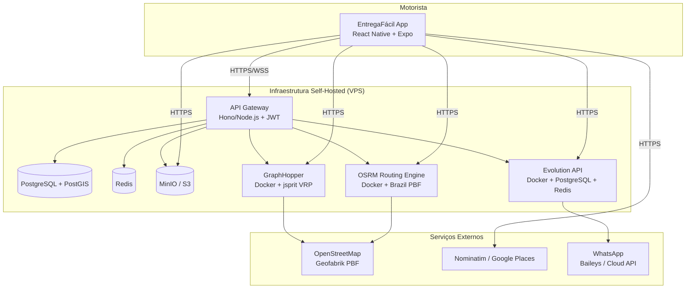
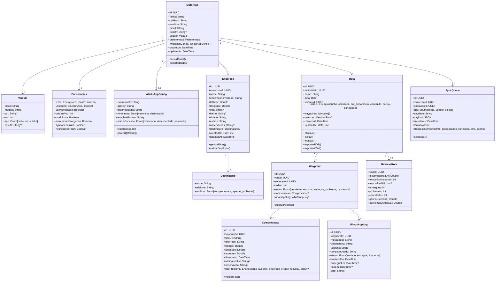
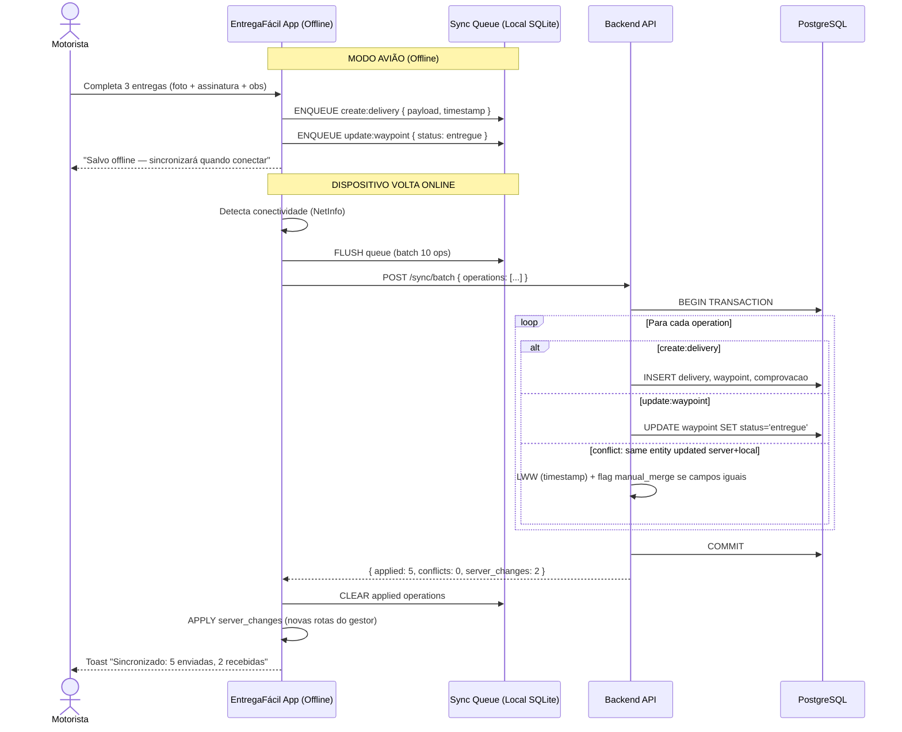
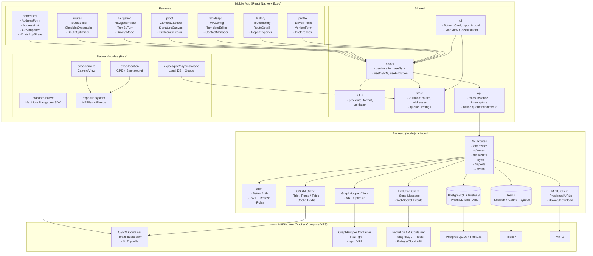
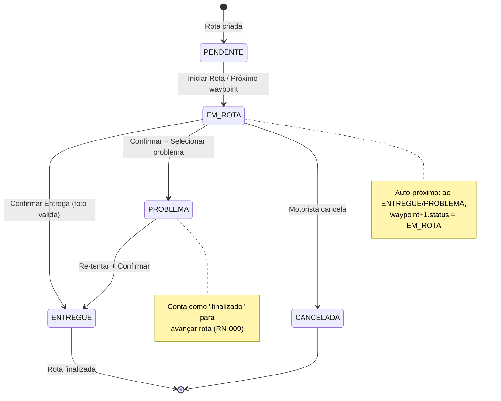
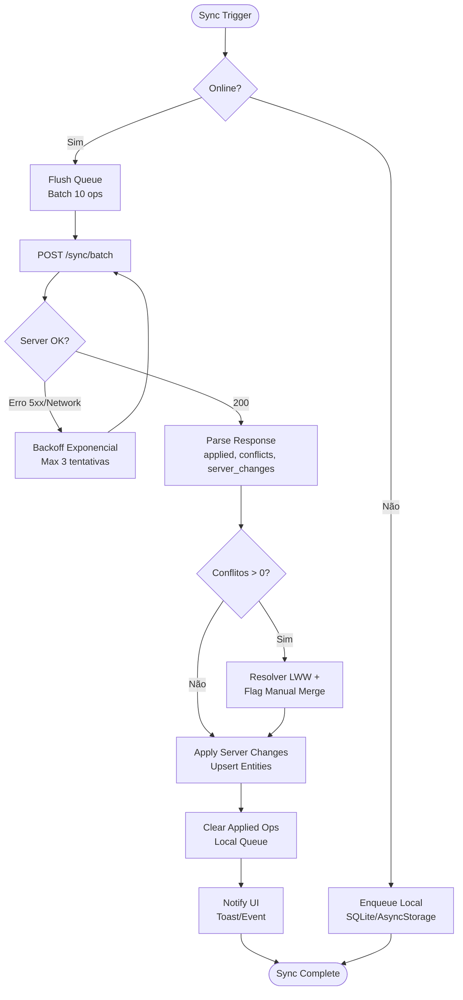

# Arquitetura e Diagramas UML — EntregaFácil

**Versão:** 0.1  
**Data:** 2026-11-17  
**Autor:** PLANMASTER  
**Branch:** develop  
**Referência:** docs/SRS.md, docs/02-benchmarks.md

---

## 1. Visão Arquitetural (C4 Level 1 — Context)



---

## 2. Diagrama de Casos de Uso (Use Case Diagram)

```mermaid
graph TB
    actor Motorista as "🏍️ Motorista"
    actor Gestor as "👨‍💼 Gestor (v0.2)"
    actor Sistema as "⚙️ Sistema (Background)"

    package "EntregaFácil App" {
        UC1[Cadastrar Endereços\nManual / CSV / WhatsApp]
        UC2[Criar Rota do Dia\nSelecionar endereços]
        UC3[Otimizar Rota\nOSRM Trip / GraphHopper VRP]
        UC4[Navegar Turn-by-Turn\nMapLibre Navigation]
        UC5[Comprovar Entrega\nFoto + GPS + Assinatura]
        UC6[Enviar WhatsApp Auto\nTemplate + Status]
        UC7[Funcionar Offline\nCache mapas + Queue sync]
        UC8[Ver Histórico/Relatórios\nExport CSV/PDF]
        UC9[Configurar Perfil/WhatsApp/Mapas]
    }

    Motorista --> UC1
    Motorista --> UC2
    Motorista --> UC3
    Motorista --> UC4
    Motorista --> UC5
    Motorista --> UC6
    Motorista --> UC7
    Motorista --> UC8
    Motorista --> UC9

    Gestor -.-> UC8
    Gestor -.-> UC2

    Sistema --> UC7
    Sistema --> UC3
    Sistema --> UC6
```

---

## 3. Diagrama de Classes / Entidades (Domain Model)



---

## 4. Diagrama de Sequência — Fluxo Principal: Otimizar + Navegar + Entregar + WhatsApp

```mermaid
sequenceDiagram
    actor Motorista
    participant App as EntregaFácil App
    participant OSRM as OSRM (VPS)
    participant MapLibre as MapLibre Navigation
    participant EVO as Evolution API
    participant WA as WhatsApp
    participant API as Backend API
    participant DB as PostgreSQL

    Motorista->>App: Abre app, seleciona "Rota Centro"
    Motorista->>App: Toca "Otimizar Rota"
    App->>OSRM: POST /trip/v1/driving/{waypoints}?steps=true&source=first&destination=last
    OSRM-->>App: { waypoints[ordem], geometry, legs[duration,distance], waypoints[waypoint_index] }
    App->>App: Reordena checklist local conforme waypoint_index
    App->>API: PUT /routes/{id} { waypoints_ordenados, geometry, metricas }
    API->>DB: UPDATE rota SET status='otimizada', geometry=?, metricas=?
    App-->>Motorista: Exibe mapa com rota + resumo "42.3 km | 1h15m | -18%"

    Motorista->>App: Toca "Iniciar Rota"
    App->>App: Waypoint[0].status = EM_ROTA
    App->>MapLibre: Iniciar navegação (polyline + steps[manobra, distancia, rua])
    MapLibre-->>Motorista: Instruções voz/visual: "Em 300m, vire à direita na Rua Augusta"

    loop Para cada waypoint
        MapLibre->>App: GPS update (location, speed, bearing)
        App->>App: Verifica proximidade waypoint atual (< 50m)
        App->>App: Verifica desvio rota (> 200m por 30s)
        alt Desvio detectado
            App->>OSRM: POST /route/v1/driving/{current};{next_waypoints}
            OSRM-->>App: Nova geometry + steps
            App->>MapLibre: Atualizar rota
        end
    end

    Motorista->>App: Chega no local, toca "Cheguei"
    App->>App: Abre câmera (expo-camera)
    Motorista->>App: Captura foto
    App->>App: Valida foto (blur check + GPS accuracy < 50m)
    Motorista->>App: (Opcional) Assina canvas
    Motorista->>App: (Opcional) Seleciona problema + observação
    Motorista->>App: Toca "Confirmar Entrega"
    App->>App: Waypoint.status = ENTREGUE, Comprovacao criada
    App->>API: POST /deliveries { waypointId, fotoUrl, assinaturaUrl, observacao, gps, timestamp }
    API->>DB: INSERT comprovacao, UPDATE waypoint
    API->>MinIO: UPLOAD foto/assinatura
    API-->>App: 201 Created { deliveryId }

    alt Config WhatsApp: remetente = destinatario
        App->>EVO: POST /message/sendText { number, text(template), instance }
        EVO->>WA: Envia via Baileys/Cloud API
        WA-->>EVO: message_id + status callbacks (WebSocket)
        EVO-->>App: WebSocket: messages.upsert { status: delivered/read }
        App->>API: POST /whatsapp/logs { waypointId, messageId, status, telefone }
        API->>DB: INSERT whatsapp_log
    end

    App->>App: Próximo waypoint.status = EM_ROTA
    App->>MapLibre: Atualizar destino para próximo waypoint
end

    Motorista->>App: Última entrega confirmada, toca "Finalizar Rota"
    App->>API: PUT /routes/{id} { status: 'concluida', metricasFinais }
    API->>DB: UPDATE rota, CALCULAR metricas finais
    App-->>Motorista: Tela resumo + botão "Exportar PDF"
```

---

## 5. Diagrama de Sequência — Sync Offline/Online



---

## 6. Diagrama de Componentes (Component Diagram)



---

## 7. Diagrama de Deploy (Deployment Diagram)

```mermaid
graph TB
    subgraph "Motorista Device"
        Device[📱 Android/iOS\nEntregaFácil App\nReact Native + Expo\nBare Workflow]
    end

    subgraph "VPS (Hetzner CX42 - 8 vCPU, 16GB RAM, 160GB SSD)"
        direction TB
        Docker[Docker Engine + Compose]
        
        subgraph "Containers"
            C_API[entregafacil-api\nHono/Node.js 20\nPort: 3000]
            C_OSRM[osrm-backend\nProject-OSRM/osrm-backend\nPort: 5000\nVolume: /data/brazil.osrm]
            C_GH[graphhopper\nGraphHopper 11.x\nPort: 8989\nVolume: /data/gh]
            C_EVO[evolution-api\nEvolution Foundation\nPort: 8080\nVolume: /data/evolution]
            C_PG[(postgres:16-alpine\nPostGIS\nPort: 5432\nVolume: pgdata)]
            C_REDIS[(redis:7-alpine\nPort: 6379\nVolume: redisdata)]
            C_MINIO[(minio/minio\nPort: 9000/9001\nVolume: miniodata)]
        end
        
        Nginx[Nginx Reverse Proxy\nSSL/TLS Termination\nPort: 80/443\nDomínio: api.entregafacil.app]
    end

    subgraph "Externo"
        DNS[DNS: api.entregafacil.app\nA record → VPS IP]
        OSM[Geofabrik Brazil PBF\nDownload mensal (cron)]
        WA[WhatsApp Servers\nBaileys WebSocket / Cloud API HTTPS]
    end

    Device -->|HTTPS/WSS| Nginx
    Nginx --> C_API
    Nginx --> C_OSRM
    Nginx --> C_GH
    Nginx --> C_EVO

    C_API --> C_PG
    C_API --> C_REDIS
    C_API --> C_MINIO
    C_API --> C_OSRM
    C_API --> C_GH
    C_API --> C_EVO

    C_EVO --> WA
    C_OSRM --> OSM
    C_GH --> OSM

    Docker --> C_API
    Docker --> C_OSRM
    Docker --> C_GH
    Docker --> C_EVO
    Docker --> C_PG
    Docker --> C_REDIS
    Docker --> C_MINIO
```

---

## 8. Diagrama de Estados (State Machine) — Waypoint Status



---

## 9. Diagrama de Atividades — Sync Engine



---

## 10. ADRs (Architecture Decision Records)

### ADR-001: Mobile Framework — React Native + Expo (Bare Workflow)

**Status:** Accepted  
**Data:** 2026-11-17  
**Contexto:** Precisamos de performance em mapas, navegação turn-by-turn, offline-first, build APK/AAB.  
**Decisão:** React Native 0.76 + Expo SDK 58 (Managed → Bare quando necessário MapLibre Navigation SDK).  
**Alternativas:** Flutter (mapas offline menos maduros), KMP (ecossistema menor), Capacitor (performance mapas).  
**Consequências:** 
- ✅ MapLibre React Native nativo, Expo Maps fallback, EAS Build cloud
- ✅ Maior pool devs, OTA updates, ecossistema maduro
- ⚠️ Bare workflow adiciona complexidade (Xcode/Android Studio local para build nativo)
- ⚠️ Tamanho APK maior que Flutter nativo

---

### ADR-002: Map Engine — MapLibre React Native (Primary) + Expo Maps (Fallback)

**Status:** Accepted  
**Data:** 2026-11-17  
**Contexto:** Mapas offline (MBTiles), turn-by-turn, vetor tiles, zero custo licença.  
**Decisão:** MapLibre React Native (676⭐, MIT) como engine principal; Expo Maps (Google Maps Android / Apple Maps iOS) apenas fallback visual em dev.  
**Alternativas:** Google Maps SDK (custo, sem offline real), Mapbox (custo, licença), Leaflet (não nativo mobile).  
**Consequências:**
- ✅ MBTiles suporte nativo, Navigation SDK turn-by-turn offline
- ✅ Style JSON customizável, 60fps nativo
- ⚠️ Requer Bare workflow para Navigation SDK
- ⚠️ Geração MBTiles (Planetiler) adiciona step no deploy

---

### ADR-003: Routing Engine — OSRM Self-Hosted (Primary) + GraphHopper (Fallback VRP)

**Status:** Accepted  
**Data:** 2026-11-17  
**Contexto:** VRP/TSP para 10-50 waypoints, offline-capable, zero custo, performance <3s.  
**Decisão:** OSRM (C++, MLD pipeline) para Trip/TSP guloso (primary); GraphHopper (Java, jsprit) para VRP com restrições (capacidade, janelas tempo) — fase 2.  
**Alternativas:** Google Routes API (pago, cloud-only), Mapbox Optimization (pago), Valhalla (complexo).  
**Consequências:**
- ✅ Zero custo licença, VPS próprio, controle total
- ✅ OSRM Trip resolve TSP 30 waypoints < 100ms
- ⚠️ GraphHopper Java consome mais RAM (2-4GB para Brasil)
- ⚠️ Pré-processamento PBF → OSRM/GraphHopper (cron mensal)

---

### ADR-004: WhatsApp Integration — Evolution API Self-Hosted (Docker)

**Status:** Accepted  
**Data:** 2026-11-17  
**Contexto:** Notificação automática entrega, template variáveis, remetente configurável, LGPD compliance.  
**Decisão:** Evolution API (10.1k⭐, Apache 2.0) self-hosted Docker, modo híbrido: Baileys (gratuito, risco banimento) + Cloud API (oficial, pago/conversa).  
**Alternativas:** WhatsApp Cloud API direto (complexo, custo), Baileys direto (manutenção, risco), Twilio/Gupshup (caro, vendor lock-in).  
**Consequências:**
- ✅ Uma API para ambos provedores, WebSocket events tempo real
- ✅ Self-hosted = controle dados LGPD, zero custo licença
- ⚠️ Baileys requer monitoramento connectionState, QR Code pairing
- ⚠️ Cloud API requer Meta Business Verification, custo por conversa

---

### ADR-005: Offline Maps — MBTiles (OpenMapTiles) + MapLibre Local Style

**Status:** Accepted  
**Data:** 2026-11-17  
**Contexto:** Navegação em áreas sem sinal, tiles vetoriais, download sob demanda WiFi.  
**Decisão:** Gerar MBTiles via Planetiler/OpenMapTiles (Brasil ~2GB, estados ~200-500MB), download no app (expo-file-system), MapLibre carrega style.json local + source MBTiles.  
**Alternativas:** Mapbox Offline (pago, vendor), GraphHopper offline (legacy, não mantido), TileServer-GL (server-side).  
**Consequências:**
- ✅ 100% offline após download, 60fps, estilo customizável
- ✅ Atualização mensal via job cron (Geofabrik → Planetiler → MBTiles → MinIO → App)
- ⚠️ Tamanho download grande (WiFi obrigatório)
- ⚠️ Geração MBTiles requer servidor potente (Planetiler multi-thread)

---

### ADR-006: Database — PostgreSQL + PostGIS + Drizzle ORM

**Status:** Accepted  
**Data:** 2026-11-17  
**Contexto:** Dados geoespaciais (rotas, waypoints, heatmaps), ACID, JSONB, type-safe ORM.  
**Decisão:** PostgreSQL 16 + PostGIS 3.5, Drizzle ORM (type-safe, SQL-like, leve), migrations versionadas.  
**Alternativas:** MongoDB (geo nativo mas sem ACID forte), SQLite (local only), Prisma (mais pesado, runtime overhead).  
**Consequências:**
- ✅ Queries geoespaciais nativas (ST_DWithin, ST_MakeLine, ST_Distance)
- ✅ Drizzle: zero runtime overhead, inferência TypeScript perfeita
- ⚠️ PostGIS adiciona complexidade no Docker (extensão)

---

### ADR-007: Sync Strategy — Optimistic UI + Background Sync + LWW Conflict Resolution

**Status:** Accepted  
**Data:** 2026-11-17  
**Contexto:** Offline-first, motorista em campo sem sinal, múltiplos devices (raro), gestor web (futuro).  
**Decisão:** Optimistic UI (atualiza local即时), queue local (SQLite) com idempotência (operation.id UUID), background sync (WorkManager/Background Fetch 15min + manual pull), conflict resolution: Last-Write-Wins por timestamp + flag manual merge se mesmo campo.  
**Alternativas:** CRDT (complexo, overkill), Server-wins (perde dados offline), Manual merge sempre (UX ruim).  
**Consequências:**
- ✅ UX fluida offline, sync confiável, auditoria completa
- ✅ Idempotência garante reentrancy segura
- ⚠️ LWW pode perder atualizações simultâneas legítimas (mitigado: flag manual merge)

---

### ADR-008: Build/Deploy — EAS Build + GitHub Actions + VPS Docker Compose

**Status:** Accepted  
**Data:** 2026-11-17  
**Contexto:** Build APK/AAB cloud, CI/CD, deploy infra imutável, rollback fácil.  
**Decisão:** EAS Build (Expo) para mobile (grátis 30 builds/mês), GitHub Actions para CI (lint, test, typecheck, SRS validation), VPS Docker Compose para backend (docker-compose.yml versionado, `docker compose up -d` deploy).  
**Alternativas:** Fastlane local (complexo), Codemagic (pago), Kubernetes (overkill), Ansible (mais complexo).  
**Consequências:**
- ✅ Build cloud sem Xcode/Android Studio local (managed workflow)
- ✅ Infra declarativa, rollback = `docker compose up -d` com tag anterior
- ⚠️ Bare workflow requer EAS Build com `android.gradle` customizado

---

## 11. Resumo de Decisões Técnicas

| ADR | Decisão | Impacto Risco | Mitigação |
|-----|---------|---------------|-----------|
| 001 | React Native + Expo Bare | Médio (complexidade nativa) | Documentação setup, scripts automatizados |
| 002 | MapLibre + Expo Maps | Baixo | Fallback testado CI |
| 003 | OSRM + GraphHopper | Baixo | Health checks, fallback automático |
| 004 | Evolution API Hybrid | Alto (Baileys banimento) | Cloud API primary, monitoramento ativo |
| 005 | MBTiles Planetiler | Médio (tamanho download) | WiFi only, progresso real, resume |
| 006 | PostgreSQL + PostGIS + Drizzle | Baixo | Migrations testadas CI |
| 007 | Optimistic + LWW + Manual | Baixo | Testes propriedade sync |
| 008 | EAS + GH Actions + Docker | Baixo | Rollback documentado |

---

**Próximo:** FASE 5 — Scrum/Backlog (Épicos, User Stories, Sprints)